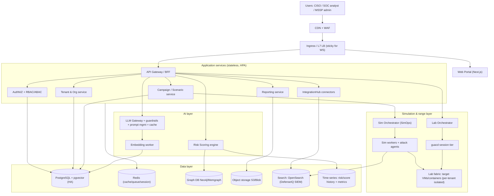
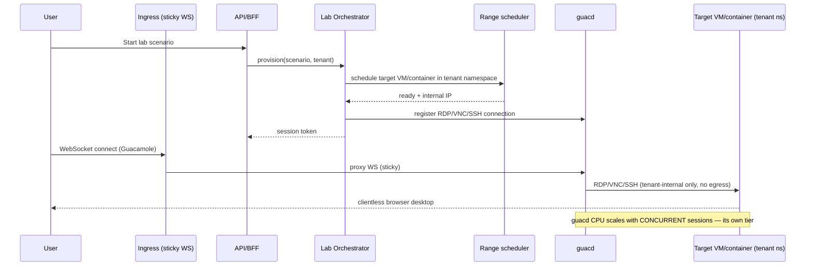
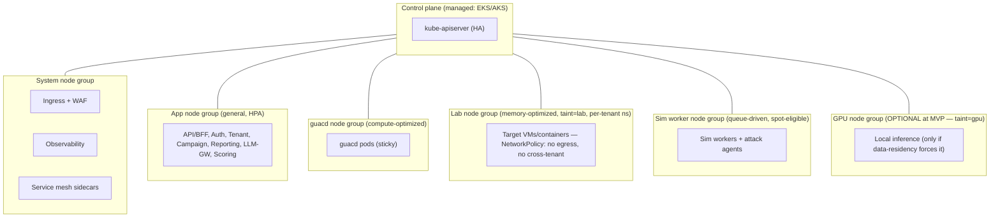
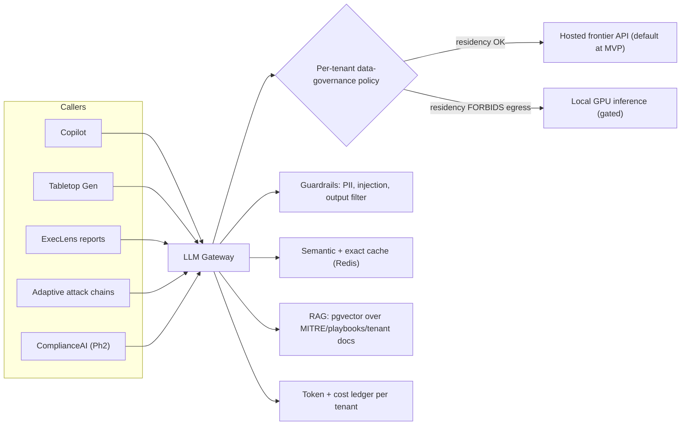
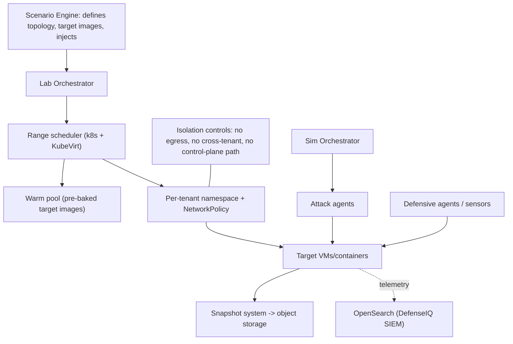

# Pwndora for Business — Architecture Review & Production Design

**Prepared for:** CTO review (BlackPerl DFIR)

---

## SECTION 0 — VERDICT (read this before anything else)

**Is the attached hardware sizing sufficient? No.** `[Certain]`

It is not under-sized at the margins — it is structurally incomplete. The sheet sizes the *inference and graph layers* and a thin app tier, and omits every layer required to actually run the product:

| What the sheet has | What the sheet is missing (all load-bearing) |
|---|---|
| 70B inference node (2× A100) | **Relational system-of-record (PostgreSQL)** |
| 2× edge inference (A10) | **Cache / queue (Redis)** |
| 2× graph DB (Neo4j/Memgraph) | **Object storage (reports, snapshots, pcaps, evidence)** |
| 2× app/API node (Guacamole co-located) | **Vector store for AI Copilot RAG** |
| | **Lab-execution compute (the entire cyber range fabric)** |
| | **guacd session tier (sized to concurrent RDP sessions)** |
| | **Search backend for DefenseIQ simulated SIEM** |
| | **Ingress / LB / WAF / NAT** |
| | **Observability, backup, DR** |
| | **Tenant network-isolation plane** |

The single most important omission: **there is no compute on which a lab instance or a simulation can execute.** The headline MVP target ("500 lab instances, 50 simultaneous simulations") is not met by any line in the BOM. `[Certain]`

**Second verdict — scope.** The brief asks for 9 modules × 5 deployment models, air-gapped sovereign included, "without major codebase changes," from day one. I recommend against this. `[Likely]` Build the SaaS multi-tenant core and *preserve seams* for the rest. Detail in §13 and §15.

---

## SECTION 1 — EXECUTIVE SUMMARY

**Overall assessment.** The platform *vision* is coherent and the *inference/graph* sizing instincts are reasonable. The *infrastructure design* does not yet exist as an executable artifact — it exists as a 7-row instance list. Before engineering starts, the gaps in §0 must be closed, the AI tier must be re-justified against 20-customer economics, and the cyber-range fabric must be designed first (it is the product, and it is absent).

**Scorecard (0–10, MVP readiness as-submitted):**

| Dimension | Score | One-line justification |
|---|---|---|
| Architecture maturity | **3** | Inference/graph thought through; no system-of-record, no lab fabric, no isolation model. |
| Scalability | **4** | Vertically scalable by accident (big nodes); no horizontal model, no autoscaling, no worker tiers. |
| Reliability / HA | **3** | DB pair + inference redundancy exist; no LB, no backup, no DR, single-region, stateful app assumptions. |
| Security | **2** | Running attacker tooling multi-tenant with no defined isolation plane is the highest risk in the design and is unaddressed. |
| Investor readiness | **6** | The *story* is investor-ready; the *architecture diligence answer* is not — a technical DD will find §0 in 20 minutes. |

Target after applying this document's MVP design: maturity 7, scalability 7, reliability 7, security 7, investor-readiness 8. `[Likely]`

---

## SECTION 2 — BUSINESS CAPABILITY → TECHNICAL SERVICE MAPPING

| Module | Core function (per vision) | Underlying technical services | Phase (per your own roadmap) |
|---|---|---|---|
| **Risk Vision 360 AI** | Continuous risk score, copilot, attack-chain gen | Scoring service + graph DB + LLM gateway + vector store + event bus | **MVP** |
| **SimOps** | Autonomous BAS, MITRE techniques | Sim orchestrator + sim workers + agent runtime + target lab fabric | **MVP** (start ~200 techniques) |
| **DefenseIQ** | SOC training, IR drills | Scenario engine + simulated SIEM (search backend) + alert-queue service + scoring | **MVP** |
| **AI Tabletop** | Scenario generation | LLM gateway (async, 70B-class) + template store + object storage | **MVP (beta)** |
| **ExecLens** | Board-ready reports | Report generator + LLM gateway + object storage (PDF) | **MVP (v1)** |
| **PurpleSync** | Red/blue automation | Orchestration over SimOps + DefenseIQ telemetry + correlation | **Phase 2** |
| **ThreatGraph** | Attack-path mapping | Graph DB (heavy) + TI ingestion + MITRE mapping service | **Phase 2** |
| **SecureCode** | SAST/DAST in CI/CD | Scanner workers + webhook ingress + risk-score integration | **Phase 2** |
| **ComplianceAI** | Audit mapping, evidence | Mapping service + LLM + evidence object store + audit log | **Phase 2** |
| **IntegrationHub** | SIEM/EDR/cloud connectors | Connector framework + webhook gateway + secrets vault | **MVP (thin) → Phase 2 (broad)** |

**Implication the brief ignores:** 4 of 9 modules are your own Phase-2 items. Sizing and architecting them at MVP depth is premature. The graph DB *replica*, for instance, primarily serves ThreatGraph (Phase 2) and can be deferred at MVP. `[Likely]`

---

## SECTION 3 — HIGH-LEVEL DESIGN (HLD)

### 3.1 Logical architecture

### 3.2 The flow the original design forgot — a live lab session

**Design rule established here:** guacd is a horizontally-scalable tier sized to *concurrent sessions*, never co-located with the API on the same node. The original sheet violates this. `[Certain]`

---

## SECTION 4 — LOW-LEVEL DESIGN (per component)

Depth is proportionate: full for load-bearing MVP components, compressed for Phase-2 modules.

### 4.1 API Gateway / BFF
- **Purpose:** single entry for web/API; auth enforcement, rate limiting, tenant routing.
- **Ports:** 443 in; gRPC/HTTP to services.
- **Deps:** Auth, Redis (rate limit/session), Postgres.
- **Storage:** none (stateless).
- **Scaling:** HPA on RPS/CPU. **HA:** ≥2 replicas across AZs.
- **Backup:** n/a. **Monitoring:** RED metrics, p95 latency, 4xx/5xx, auth-fail rate.

### 4.2 Lab Orchestrator (NEW — absent in original)
- **Purpose:** provision/teardown lab environments per tenant; broker Guacamole connections; enforce TTL and quotas.
- **Ports:** internal API; talks to k8s API and guacd.
- **Deps:** k8s scheduler, Redis (session state), Postgres (lab catalog), object storage (snapshots).
- **Scaling:** HPA; idempotent reconciler pattern. **HA:** ≥2 + leader election.
- **Backup:** lab templates + snapshots → object storage. **Monitoring:** provision latency, active labs, failed provisions, quota breaches.

### 4.3 guacd session tier (NEW as a tier)
- **Purpose:** transcode RDP/VNC/SSH ↔ WebSocket for clientless browser access.
- **Ports:** 4822 internal; WS via ingress.
- **Scaling:** **horizontal, sized to concurrent sessions** (~40–60 active RDP sessions/vCPU as planning rule). `[Guessing]` **HA:** N+1, sticky sessions at LB.
- **Monitoring:** concurrent sessions, CPU/session, frame latency, dropped sessions.

### 4.4 Sim Orchestrator + Sim Workers (SimOps)
- **Purpose:** select/sequence/execute attack techniques against target fabric; capture block/bypass outcomes.
- **Deps:** lab fabric, LLM gateway (adaptive chains), Postgres (results), search (telemetry), graph DB (scoring feed).
- **Scaling:** worker pool (queue-driven, Redis/SQS). **HA:** stateless workers, retried jobs.
- **Monitoring:** sims active, technique pass/fail, queue depth, worker saturation.

### 4.5 Risk Scoring engine (Risk Vision 360)
- **Purpose:** continuous 0–1000 score from sim outcomes + control coverage + SOC metrics.
- **Deps:** graph DB, time-series, Postgres, event bus.
- **Scaling:** event-driven; cacheable reads. **HA:** ≥2.
- **Monitoring:** score-recompute latency, staleness, drift after CVE/config events.

### 4.6 LLM Gateway (AI)
- **Purpose:** single egress for all model calls; routing (hosted vs local), guardrails, prompt versioning, response cache, token accounting, **per-tenant data-governance policy** (decides whether a tenant's data may leave to a hosted API).
- **Deps:** model backends (hosted API and/or local GPU), Redis (cache), Postgres (prompt registry, token ledger).
- **Scaling:** stateless; cache-heavy. **HA:** ≥2; circuit-breaker to fallback model.
- **Monitoring:** tokens/tenant, cost/tenant, cache hit rate, guardrail blocks, latency, model errors.

### 4.7 Data components — see §6.

### 4.8 Phase-2 modules (compressed)
PurpleSync (orchestration over SimOps+DefenseIQ), ThreatGraph (graph-heavy + TI ingestion), SecureCode (scanner workers + CI webhooks), ComplianceAI (mapping + evidence store) follow the same pattern: stateless service + worker pool + their datastore. **Do not size at MVP.** Reserve the namespaces and event-bus topics now; build when the paying customer asks.

---

## SECTION 5 — INFRASTRUCTURE (KUBERNETES) ARCHITECTURE

**Decisions:**
- Managed control plane (EKS/AKS). Don't self-manage k8s control plane pre-Series-A. `[Likely]`
- **Hard node-group separation** with taints/tolerations: lab and sim workloads (which run *offensive tooling*) never schedule onto system/app/data nodes. This is a security control, not just bin-packing. `[Certain]`
- Service mesh (Linkerd over Istio at this scale — lower operational tax) for mTLS + per-service authz. `[Likely]`
- Secrets: external secrets operator → cloud KMS-backed vault (or HashiCorp Vault). No secrets in manifests/env. `[Certain]`
- Lab fabric: containers where the scenario allows (cheap, fast), VMs (KubeVirt or cloud VMs) only where Windows/AD/OT realism requires it. **OS mix is your #1 cost lever — quantify it before committing.** `[Likely]`

---

## SECTION 6 — DATABASE ARCHITECTURE

| Store | Engine | MVP role | HA / replication | Backup | Retention/DR |
|---|---|---|---|---|---|
| **Relational (NEW)** | PostgreSQL (Aurora/RDS or self-managed) + **pgvector** | Tenants, users, RBAC, campaigns, scores, billing, **audit**, prompt registry, embeddings | Primary + sync standby (multi-AZ) + 1 read replica | Automated daily + WAL/PITR to object store | PITR 7–35d; cross-region copy = Stage 2 |
| **Cache/queue (NEW)** | Redis | Sessions, rate limit, job queues, guacd session map, score cache | Primary + replica | RDB/AOF snapshot | Ephemeral; rebuildable |
| **Graph** | Neo4j / Memgraph | Real-time scoring, ThreatGraph (Ph2) | Primary at MVP; **replica deferred to Ph2** | Daily dump → object store | Rebuildable from PG events |
| **Object (NEW)** | S3 / Blob | Reports, pcaps, snapshots, evidence, model artifacts | Cloud-native 11-nines | Versioning + lifecycle | Tiering (see §14); cross-region = Stage 2 |
| **Search (NEW)** | OpenSearch | DefenseIQ simulated SIEM, sim telemetry, alert queues | 3-node MVP (or defer if DefenseIQ SIEM realism is thin at launch) | Snapshot → object store | 30–90d hot, then purge |
| **Time-series (NEW)** | Prometheus + Timescale/VictoriaMetrics | Infra metrics + risk-score history | HA pair | Remote-write to durable store | 15d metrics / 1y score history |

**Key correction:** the original BOM has **no Postgres at all.** Every tenant, user, RBAC grant, campaign, and audit record needs a transactional home. **pgvector** lets you serve AI-Copilot RAG from Postgres at MVP — **do not stand up a separate Qdrant/Weaviate yet.** `[Likely]`

---

## SECTION 7 — AI ARCHITECTURE

**The contested recommendation — say it plainly:**

I disagree with self-hosting a 70B on 2× A100 at MVP. **Here's what I'd do instead:** default all 70B-class workloads (tabletop gen, exec reports, async copilot reasoning) to a **hosted frontier API**, behind the gateway, behind a per-tenant policy switch. **The risk in the original approach:** ~$7.5–9.5K/mo `[Guessing]` of always-on GPU spend at 20 customers, for low-QPS async work that a token-metered API serves more cheaply and with zero ops burden — capital spent optimizing the "AI is the OS" narrative, not unit economics.

**When self-hosting becomes correct (the gate):** the moment a signed BFSI/gov customer's data-governance terms forbid telemetry leaving their boundary, *or* monthly hosted-token spend durably exceeds amortized GPU cost (~$7–10K/mo). Until one of those triggers, keep GPU optional. The architecture already supports flipping the switch — that's the point of the gateway. `[Likely]`

- **Embedding layer:** small/cheap; can run on CPU or hosted embeddings at MVP.
- **Edge inference (the 2× A10 in original):** the *redundant* A10 is over-provisioned at MVP. Start with at most one small GPU node, and only if "active simulation adaptation" genuinely needs sub-second local inference; otherwise route it through the gateway too. `[Likely]`
- **Guardrails are non-optional** here specifically because the AI generates *offensive content* (attack chains, tabletop injects). Prompt-injection and output filtering protect against a tenant weaponizing the copilot against your control plane or other tenants. `[Likely]`

---

## SECTION 8 — CYBER RANGE ARCHITECTURE (the section the original omitted entirely)

This is the product. It had **zero** sizing in the input. Everything here is net-new.

**Components & responsibilities:** Scenario Engine (topology + inject definitions), Lab Orchestrator (lifecycle/TTL/quota), Range Scheduler (placement on tainted lab nodes), Warm Pool (pre-baked images to hit sub-30s start), Attack Agents (technique execution), Defensive Agents/Sensors (telemetry capture), Snapshot System (reset/forensics → object store), Isolation Controls (the security spine — §9).

**Sizing the fabric (the number that was missing):** `[Likely]`/`[Guessing]`

| Lab type | Per-instance | 200 concurrent | 500 concurrent (design ceiling) |
|---|---|---|---|
| Linux container (Kali/vuln-app) | 2 vCPU / 4 GB | ~400 vCPU / 800 GB (≈250 phys vCPU @ overcommit) | ~1000 vCPU / 2 TB |
| Windows VM (AD/SOC realism) | 2–4 vCPU / 8 GB | ~600 vCPU / 1.6 TB | ~1500 vCPU / 4 TB + Windows licensing |

**Planning fleet (assume ~70% Linux / 30% Windows, ~200 concurrent at MVP, 500 as ceiling):** ~6–8 memory-optimized nodes (e.g., 32 vCPU / 256 GB class), spot-eligible for stateless containers, on-demand for stateful Windows VMs. **"500 lab instances" should mean 500 *registered/pooled*, not 500 concurrently hot** — clarify this, because the two readings differ by ~2–3× in cost. `[Likely]`

---

## SECTION 9 — SECURITY ARCHITECTURE

**This is where the original design is most dangerous, because it runs attacker tooling multi-tenant with no defined isolation plane.** `[Certain]`

**Tenant isolation (the spine):**
- Each tenant's labs run in a dedicated namespace with a default-deny `NetworkPolicy`: **no internet egress, no cross-namespace traffic, no route to the control plane or data plane.** `[Certain]`
- Lab/sim node groups are tainted and physically separate from app/data nodes (§5).
- For BFSI/gov tenants demanding stronger isolation: per-tenant subnet/VPC or dedicated node pool (a Dedicated-Tenant SKU, §13) — this is the upsell, not the MVP default.

**Identity & access:** OIDC SSO + SCIM (enterprise table-stakes), **RBAC** for coarse roles, **ABAC** for tenant/data-scoped decisions, short-lived tokens.

**Secrets/KMS/encryption:** KMS-backed vault; envelope encryption; encryption in transit (mTLS via mesh) and at rest (volumes + object store + DB); customer-managed keys (CMK) for enterprise/sovereign.

**Audit logging:** immutable, append-only, tenant-scoped, exportable — this is also your ComplianceAI evidence substrate (§4.8). Not optional for BFSI. `[Certain]`

**Perimeter & supply chain:** WAF + L7 LB; signed images, SBOM, admission control (block unsigned/critical-CVE images), runtime security (Falco) on lab nodes specifically — you *expect* malicious behavior there, so you must distinguish scenario-intended from real compromise. `[Likely]`

**Compliance readiness (GCC-relevant for your UAE/Saudi GTM):** `[Likely]`
- **SOC 2 Type I** at MVP (your roadmap already says so), Type II as you accumulate evidence.
- **ISO 27001** ISMS scoped to the SaaS plane.
- **SAMA CSF** (Saudi BFSI): in-Kingdom data residency, the governance/ resilience domains — drives a KSA region or sovereign SKU before you can sell to a Saudi bank.
- **NCA ECC-1** (Saudi gov): national data residency + control families — a Phase-3 gate, not MVP. Design the seam (deployment-agnostic packaging), don't build it now.

---

## SECTION 10 — OBSERVABILITY

- **Logs:** structured, tenant-tagged → OpenSearch (shared with DefenseIQ backend, separate index pattern). `[Likely]`
- **Metrics:** Prometheus + Grafana; RED for services, USE for nodes, plus product SLIs.
- **Tracing:** OpenTelemetry end-to-end (especially the provision→guacd→lab path).
- **SIEM integration:** ship platform audit logs to the customer's SIEM via IntegrationHub (this is also a sales feature).
- **SLOs (propose, MVP):** API availability 99.9%; lab provision p95 < 30s (warm pool) / < 90s (cold); copilot p95 < 8s (async tasks excluded). Error budget tracked per SLO; budget burn pauses non-critical deploys. Don't promise 99.99% at MVP — your vision's 99.9% enterprise tier is the right target. `[Likely]`

---

## SECTION 11 — DISASTER RECOVERY

| Tier | RPO | RTO | Mechanism |
|---|---|---|---|
| MVP (single region, multi-AZ) | ≤15 min | ≤4 h | Postgres PITR/WAL to object store; IaC redeploy; graph rebuildable from PG events; object store versioned |
| Stage 2 (cross-region warm) | ≤5 min | ≤1 h | Async cross-region replication (PG + object), pre-provisioned standby cluster |
| Enterprise/Sovereign | per contract | per contract | Dedicated/region-pinned, CMK, runbook-tested failover |

**Everything is reconstructable from two sources of truth: Postgres + object storage.** Treat graph/search/cache/labs as rebuildable. Lab instances are ephemeral by design — DR for labs = re-provision from templates, not backup. `[Certain]`

---

## SECTION 12 — RECOMMENDED HARDWARE (by phase) + FINDINGS

### 12.1 Findings table (existing vs recommended) — explicitly requested

| Component | Existing | Recommended | Reason |
|---|---|---|---|
| 70B inference (2× A100) | g6e.12xlarge always-on | **Hosted API via gateway; GPU optional/gated** | Async low-QPS work; ~$8K/mo capex unjustified pre-PMF unless residency forces local. |
| Edge inference (2× A10) | 2 nodes | **0–1 node at MVP** | Redundant A10 over-provisioned; route via gateway. |
| Graph DB | Primary + replica | **Primary now; replica Phase 2** | Replica mainly serves ThreatGraph (Ph2). |
| App/API + Guacamole | 2× m7g.xlarge, co-located | **App tier (2×) + separate guacd tier (2×, compute-opt)** | guacd CPU scales with concurrent RDP sessions; co-location fails at ~200 sessions. |
| PostgreSQL | **Absent** | **Primary + standby + replica (multi-AZ)** | No system-of-record exists; everything transactional lives here. |
| Redis | **Absent** | **Primary + replica** | Sessions, queues, cache, guacd session map. |
| Object storage | **Absent** | **S3/Blob + versioning + lifecycle** | Reports, pcaps, snapshots, evidence, model artifacts. |
| Vector store | **Absent** | **pgvector on Postgres (MVP)** | Copilot RAG; avoid separate vector DB until scale demands. |
| **Lab fabric** | **Absent** | **6–8 memory-opt nodes, tainted, per-tenant isolated** | The product cannot run without it. Single biggest gap. |
| Search (OpenSearch) | **Absent** | **3-node (or defer if SIEM realism thin)** | DefenseIQ simulated SIEM / alert queues. |
| Ingress/WAF/LB/NAT | **Absent** | **L7 LB + WAF + sticky WS + NAT** | No way in/out; Guacamole WS needs sticky + tuned idle timeout. |
| Observability | **Absent** | **Prom/Grafana + OTel + logs** | No metrics/traces/logs today. |
| Backup/DR | **Absent** | **PITR + object versioning + IaC** | No recovery path today. |
| Tenant isolation plane | **Absent** | **NetworkPolicy default-deny + node taints + mesh mTLS** | Running offensive tooling multi-tenant is the top risk. |

### 12.2 MVP infrastructure BOM (corrected) — 20 customers / 200 concurrent / ~200 hot labs

| Component | Qty | CPU | RAM | Storage | Notes |
|---|---|---|---|---|---|
| App/API node (ARM) | 2 | 8 vCPU | 32 GB | 250 GB | stateless, HPA |
| guacd node (compute-opt) | 2 | 8 vCPU | 16 GB | 100 GB | sized to concurrent sessions |
| Lab fabric node (mem-opt) | 6–8 | 32 vCPU | 256 GB | 500 GB NVMe | tainted, per-tenant ns, spot for Linux |
| Sim worker node | 2 | 16 vCPU | 32 GB | 200 GB | queue-driven, spot-eligible |
| Graph DB (ARM) | 1 | 16 vCPU | 64 GB | 1 TB NVMe | replica deferred |
| PostgreSQL | 1 prim + 1 standby + 1 replica | 4–8 vCPU | 32 GB | 500 GB + WAL | managed preferred |
| Redis | 1 + 1 | 2 vCPU | 13 GB | — | managed |
| OpenSearch | 3 | 2 vCPU | 16 GB | 500 GB | or defer |
| GPU (optional) | 0–1 | 8 vCPU | 32 GB | 500 GB | only if residency forces local inference |
| Object storage | — | — | — | pay-as-you-go | reports/snapshots/evidence |
| Ingress/WAF/NAT/obs | managed | — | — | — | |

### 12.3 Phase scaling table

| Phase | Customers | Concurrent users | Hot labs | Sim concurrency | Compute shape | GPU |
|---|---|---|---|---|---|---|
| **MVP** | 20 | 200 | ~200 (500 pooled) | 50 | BOM above | hosted API |
| **Growth 1** | 100 | ~1,000 | ~800 | 200 | +lab nodes, +guacd, PG read replicas, graph replica, autoscaling | hosted; eval local |
| **Growth 2** | 500 | ~5,000 | ~3,500 | 1,000 | multi-AZ→multi-region, cell-based per large tenant, OpenSearch cluster | likely local GPU fleet |
| **Enterprise** | dedicated tenants | per-tenant | per-tenant | per-tenant | Dedicated-Tenant SKU, CMK | per contract |
| **Government** | sovereign/airgap | per-deployment | per-deployment | per-deployment | packaged on-prem/airgap SKU | local mandatory |

---

## SECTION 13 — DEPLOYMENT MODELS

| Model | Build when | What changes | Hardware delta |
|---|---|---|---|
| **SaaS multi-tenant** | **Now (MVP)** | Baseline | The §12.2 BOM |
| **Dedicated enterprise tenant** | **Growth 1** (first big logo asks) | Tenant gets own namespace/node pool/CMK; same codebase | +1 node pool per tenant |
| **Sovereign cloud (in-region)** | **Growth 2** (KSA/SAMA forces it) | Region-pinned deploy, in-Kingdom data, local inference | A regional copy of the stack |
| **On-prem** | **Phase 3** | Packaged k8s (k3s/RKE2), customer hardware, local everything | Customer-supplied; sizing per §12 |
| **Air-gapped defense** | **Phase 3 (defer)** | No internet; offline model + image registry; manual TI updates | Local GPU mandatory; hardened |

**The seam you must preserve from day one** so these are packaging, not rewrites: deployment-agnostic IaC (Helm/Kustomize), **no hard coupling to a specific cloud's managed service** behind an interface (DB, object store, secrets, inference all pluggable), offline-capable artifact pipeline, and the LLM gateway's local/hosted switch. Build the seam; do **not** build the air-gap product now. `[Likely]`

---

## SECTION 14 — COST OPTIMIZATION

- **Reserved/Savings Plans** for steady tiers (app, graph, PG, guacd baseline): ~30–50% off on-demand. `[Likely]`
- **Spot** for stateless Linux lab containers and sim workers (interruption-tolerant): largest single saving on the fabric. `[Likely]`
- **Warm-pool sizing** to TTL aggressively — idle labs are the silent cost; reap on inactivity.
- **Hosted LLM at MVP** = the biggest capex avoidance vs the original GPU plan (§7).
- **Storage tiering:** hot (recent reports/snapshots) → infrequent → archive (old evidence); lifecycle policies.
- **GPU sharing** (MIG/time-slicing) only once you self-host — not at MVP.
- **Caching** (LLM semantic cache, score cache) cuts both token spend and DB load.

**Indicative corrected MVP run-rate:** ~**$6–9K/mo on-demand**, ~**$4–6K/mo** with reserved + spot. `[Guessing]` Compare: the original partial BOM is already ~$10–12K/mo (70B node dominates) **and cannot run a lab.** These numbers are planning-grade and move with cloud pricing and your Linux/Windows lab mix — validate against a live pull before you commit budget.

---

## SECTION 15 — FINAL RECOMMENDATION (direct answers)

1. **Is the current sizing sufficient?** No. It is missing the system-of-record, the cache, object storage, the vector store, search, ingress, observability, backup, the isolation plane, and the entire lab-execution fabric. It sizes the head and omits the body. `[Certain]`

2. **True minimum production deployment?** The §12.2 BOM: 2 app + 2 guacd + 6–8 lab + 2 sim + 1 graph + Postgres (3) + Redis (2) + OpenSearch (3, or defer) + object storage + managed ingress/obs, with hosted LLM. GPU optional. `[Likely]`

3. **What to launch as MVP?** Risk Vision 360 (scoring + copilot), SimOps (~200 techniques), DefenseIQ (SOC sim), AI Tabletop (beta), ExecLens (v1), thin IntegrationHub — i.e., exactly your roadmap's Phase 1. `[Certain]`

4. **Defer to Phase 2?** PurpleSync, ThreatGraph, SecureCode, ComplianceAI, the graph replica, the self-hosted 70B, OpenSearch-as-full-SIEM, cross-region DR. `[Likely]`

5. **Redesign NOW, before code:** (a) the tenant **isolation plane** — it's a security primitive, retrofitting it is painful and unsellable to BFSI; (b) **guacd as its own tier**; (c) introduce **Postgres + object storage** as first-class; (d) the **LLM gateway** with the local/hosted policy switch; (e) the **deployment-agnostic seam** so sovereign is later-packaging not a rewrite. `[Likely]`

6. **Architecture for the stated goals:**
   - **100 customers / 12 mo:** the MVP design + autoscaling + read replicas + graph replica + dedicated-tenant SKU for the first big logos. No re-architecture needed if seams are preserved. `[Likely]`
   - **500 customers / 24 mo:** multi-region, cell-based isolation for large tenants, OpenSearch cluster, likely a local GPU fleet, cross-region DR. `[Likely]`
   - **Gov/defense / 36 mo:** sovereign + air-gapped as separate **packaged SKUs** off the same codebase — feasible *only if* the §13 seam was preserved from MVP. If it wasn't, this becomes a rewrite. `[Likely]`

**The one decision that matters most right now:** stop sizing AI brains and start designing the lab fabric and its isolation, because that is the product, that is what BFSI diligence will probe, and that is the only part of the system the current sheet doesn't touch at all.
